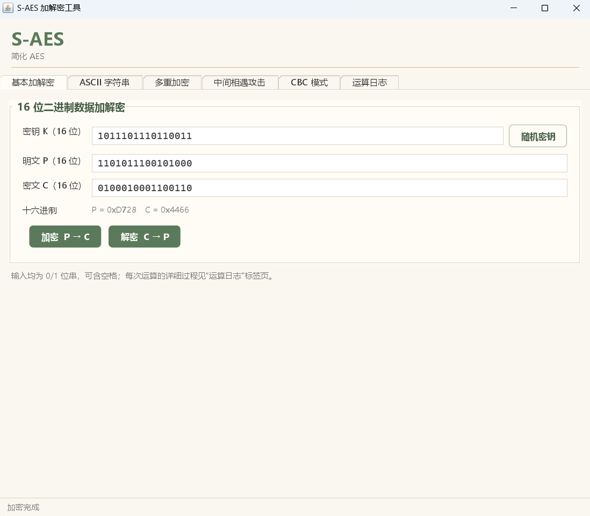
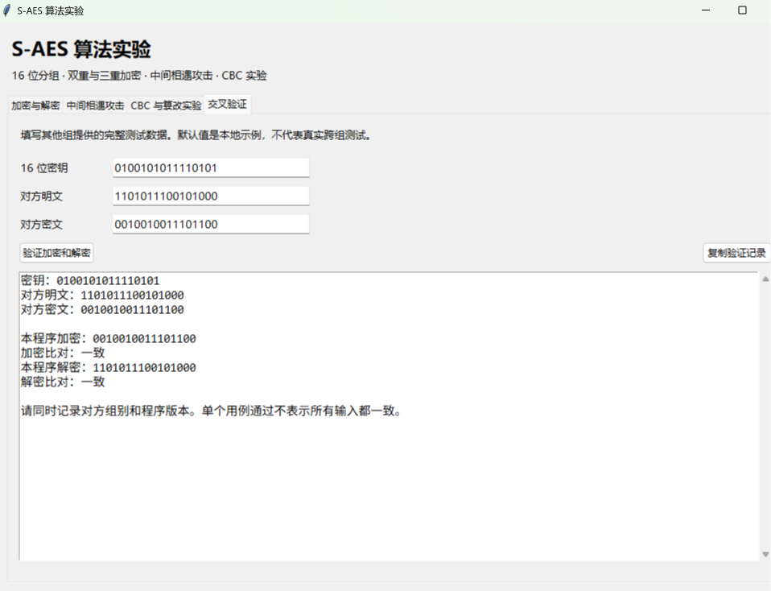
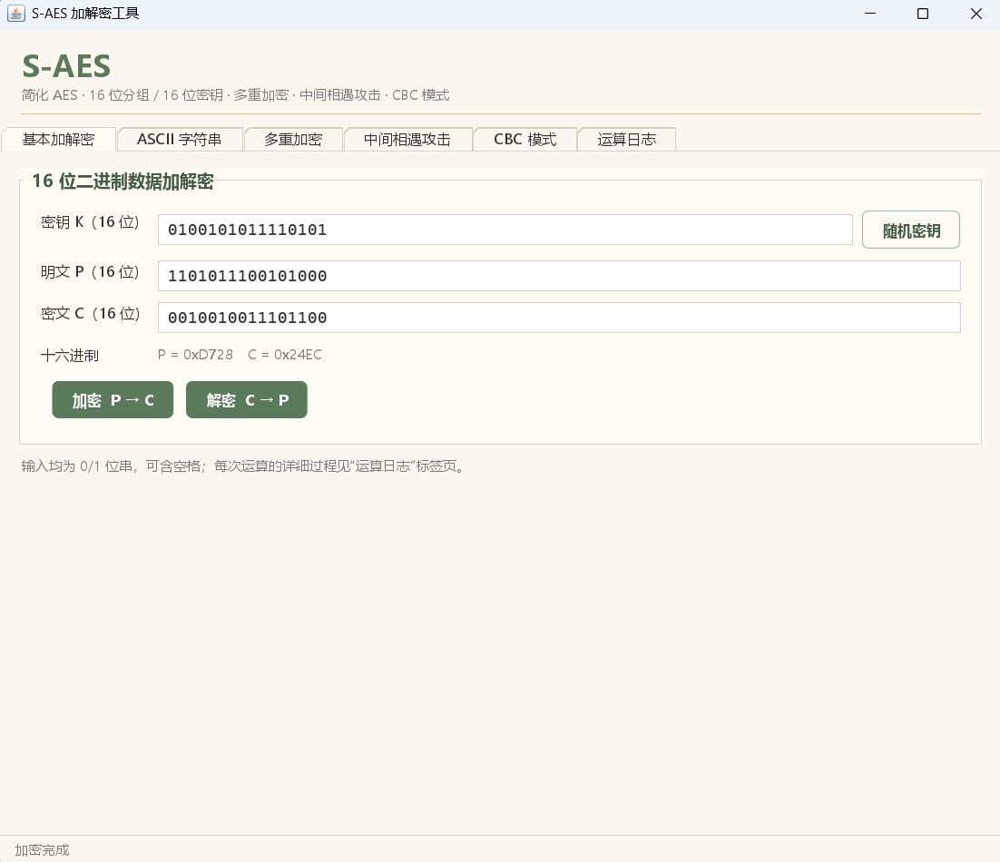
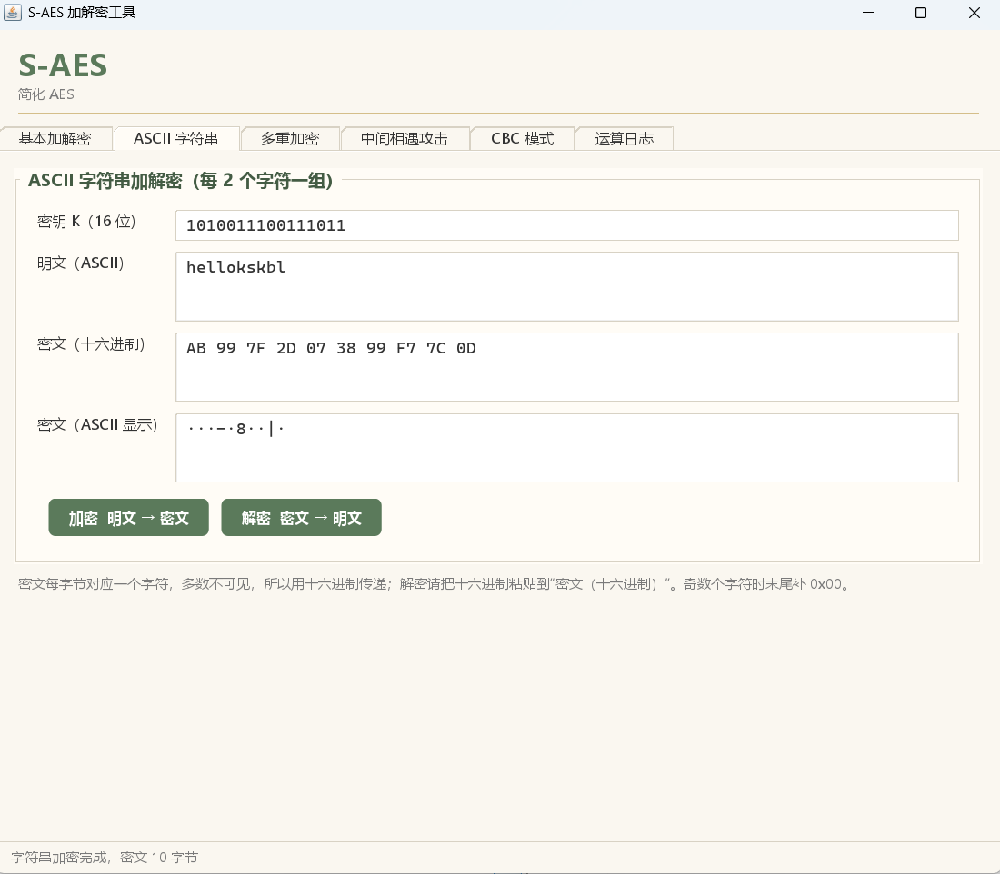
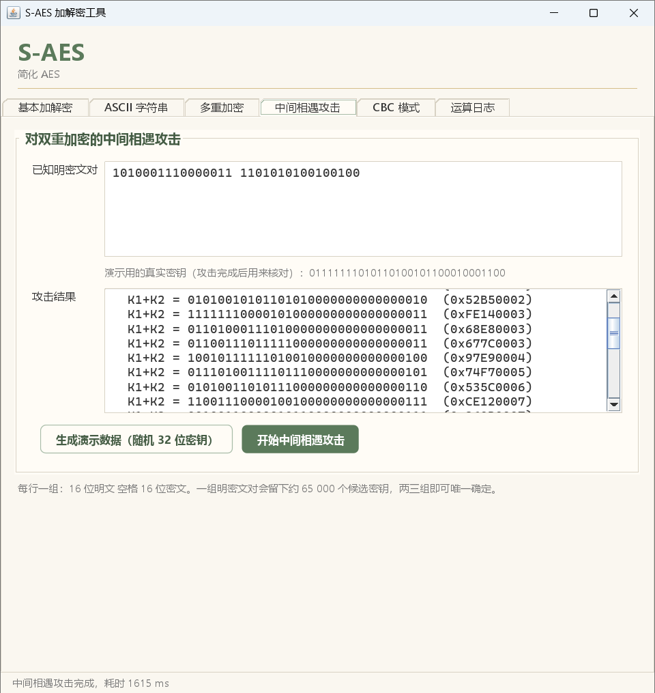
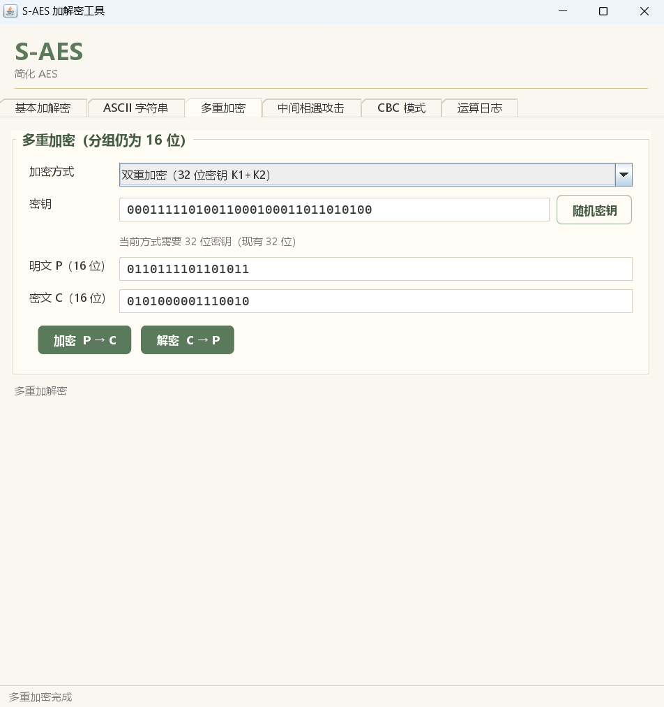

# S-AES 加解密工具 测试报告

> 报告里的数据都来自 `SAESSelfTest` 的实际运行输出。

## 目录

- [一、测试概述](#一测试概述)
- [二、第 1 关：基本测试](#二第-1-关基本测试)
- [三、第 2 关：交叉测试](#三第-2-关交叉测试)
- [四、第 3 关：扩展功能](#四第-3-关扩展功能)
- [五、第 4 关：多重加密](#五第-4-关多重加密)
- [六、第 5 关：工作模式](#六第-5-关工作模式)
- [七、测试结论](#七测试结论)
- [附录 A：测试环境](#附录-a测试环境)
- [附录 B：测试截图清单](#附录-b测试截图清单)

---

## 一、测试概述

### 1.1 测试目的

验证 S-AES 程序在以下五个方面满足课程要求：

1. 基本加解密：16 位明文 + 16 位密钥 → 16 位密文，GUI 可交互
2. 交叉测试：与教材附录 D 的算法标准一致，能和他组程序互相加解密
3. 扩展功能：ASCII 字符串（2 Bytes 一组）加解密
4. 多重加密：双重加密、中间相遇攻击、三重加密
5. 工作模式：CBC 模式，并观察篡改密文的影响

### 1.2 测试方法

- **自动测试**：`SAESSelfTest` 共 38 项检查，全部通过
- **手工测试**：通过图形界面输入同样的数据并截图
- **运行方式**：`java -cp out saes.SAESSelfTest`

---

## 二、第 1 关：基本测试

### 2.1 测试目标

输入 16 位明文和 16 位密钥，得到 16 位密文；用同一密钥解密能还原明文。

### 2.2 算法单元核对（对照教材附录 D）

| 检查项                           | 期望（教材）     | 实际          | 结果 |
| -------------------------------- | ---------------- | ------------- | ---- |
| GF(2⁴) 乘法 4•C                  | 5                | 5             | ✅    |
| GF(2⁴) 乘法 9•4                  | 2                | 2             | ✅    |
| 9 ⊕ 2•4（逆列混淆证明）          | 1                | 1             | ✅    |
| 9•4 ⊕ 2（逆列混淆证明）          | 0                | 0             | ✅    |
| S 盒用“求逆 + 仿射变换”重新生成  | 与表 D.1(a) 一致 | 16 项全部一致 | ✅    |
| 逆 S 盒与 S 盒互逆               | 互逆             | 互逆          | ✅    |
| 半字节代替例子 `8 1 / A C`       | `6 4 / 0 C`      | `6 4 / 0 C`   | ✅    |
| 列混淆例子 `[1 4;4 1]·[6 4;C 0]` | `[3 4;7 3]`      | `[3 4;7 3]`   | ✅    |
| 密钥扩展（密钥 2D55）w2          | `10111100`       | `10111100`    | ✅    |
| 密钥扩展 w3                      | `11101001`       | `11101001`    | ✅    |
| 密钥扩展 w4                      | `10100011`       | `10100011`    | ✅    |
| 密钥扩展 w5                      | `01001010`       | `01001010`    | ✅    |

### 2.3 加解密测试用例

| 编号 | 明文 P             | 密钥 K             | 密文 C             | 十六进制 | 解密还原 |
| ---- | ------------------ | ------------------ | ------------------ | -------- | -------- |
| 1    | `1101011100101000` | `0100101011110101` | `0010010011101100` | 0x24EC   | ✅        |
| 2    | `0001010010110001` | `1101100001010010` | `1101011011000111` | 0xD6C7   | ✅        |

用例 1 是 S-AES 资料中常被引用的验证向量（明文 6F6B、密钥 A73B、密文 0738），本程序的结果与之相同。

### 2.4 逐步运算过程（用例 1）

下面是界面“运算日志”输出的完整过程，可以逐行手算核对

```text
========== 16 位加密 ==========
  输入                    : 明文 P = 0001 0100 1011 0001 (0x14B1)，密钥 K = 1101 1000 0101 0010 (0xD852)
  密钥扩展                : w0..w5 = D8 52 F9 AB F9 52
  轮密钥                  : K0 = 1101 1000 0101 0010 (0xD852)，K1 = 1111 1001 1010 1011 (0xF9AB)，K2 = 1111 1001 0101 0010 (0xF952)
  第0轮 AK(K0)            : 1100 1100 1110 0011 (0xCCE3)
  第1轮 半字节代替 NS     : 1100 1100 1111 1011 (0xCCFB)
  第1轮 行移位 SR         : 1100 1011 1111 1100 (0xCBFC)
  第1轮 列混淆 MC         : 0110 1110 1010 0101 (0x6EA5)
  第1轮 AK(K1)            : 1001 0111 0000 1110 (0x970E)
  第2轮 半字节代替 NS     : 0010 0101 1001 1111 (0x259F)
  第2轮 行移位 SR         : 0010 1111 1001 0101 (0x2F95)
  第2轮 AK(K2)            : 1101 0110 1100 0111 (0xD6C7)
  输出                    : 密文 C = 1101 0110 1100 0111 (0xD6C7)

========== 16 位解密 ==========
  输入                    : 密文 C = 1101 0110 1100 0111 (0xD6C7)，密钥 K = 0110 1011 0011 0000 (0x6B30)
  轮密钥                  : K0 = 0110 1011 0011 0000 (0x6B30)，K1 = 0111 0000 0100 0000 (0x7040)，K2 = 1101 1101 1001 1101 (0xDD9D)
  第2轮逆 AK(K2)          : 0000 1011 0101 1010 (0x0B5A)
  第2轮逆 行移位 ISR      : 0000 1010 0101 1011 (0x0A5B)
  第2轮逆 半字节代替 INS  : 1010 0010 0111 0011 (0xA273)
  第1轮逆 AK(K1)          : 1101 0010 0011 0011 (0xD233)
  第1轮逆 列混淆 IMC      : 1011 1000 1110 1110 (0xB8EE)
  第1轮逆 行移位 ISR      : 1011 1110 1110 1000 (0xBEE8)
  第1轮逆 半字节代替 INS  : 0011 1101 1101 0110 (0x3DD6)
  第0轮逆 AK(K0)          : 0101 0110 1110 0110 (0x56E6)
  输出                    : 明文 P = 0101 0110 1110 0110 (0x56E6)
```

解密每一步的结果与加密的对应步骤逐个互为逆过程。

### 2.5 穷尽性测试

| 测试                                              | 规模                                        | 结果                   |
| ------------------------------------------------- | ------------------------------------------- | ---------------------- |
| 随机密钥 × 全部明文，加密后再解密                 | 20 个随机密钥 × 65536 个明文 = 1 310 720 次 | 全部还原 ✅             |
| 固定密钥（A73B）下 65536 个明文的密文是否互不相同 | 65536                                       | 互不相同，是一一对应 ✅ |

### 2.6 边界与错误输入测试

| 输入                                          | 程序提示                               |
| --------------------------------------------- | -------------------------------------- |
| 明文只有 15 位                                | 明文必须是 16 位二进制数，当前为 15 位 |
| 密钥含字母                                    | 密钥只能包含 0 和 1                    |
| 明文含空格但位数正确（`0110 1111 0110 1011`） | 正常处理（空格被忽略）                 |
| 全 0 明文 + 全 0 密钥                         | 正常，密文 `0000011100011110`          |
| 全 1 明文 + 全 1 密钥                         | 正常，密文 `0101001101000011`          |

### 2.7 测试截图

- [测试日志](Screenshots/第一关基本测试/加解密测试.png)

界面预览：



### 2.8 结论

第 1 关通过：16 位明文 + 16 位密钥可得到正确的 16 位密文，解密能 100% 还原，且与教材例子逐项吻合。

---

## 三、第 2 关：交叉测试

### 3.1 测试目标

不同小组独立编写的程序，使用相同的密钥对同一明文加密，得到相同的密文；A 组的密文交给 B 组的程序解密，能还原 A 组的明文。

### 3.2 转换装置一致性核对

| 单元           | 本程序采用的取值                                                      | 与教材一致 |
| -------------- | --------------------------------------------------------------------- | ---------- |
| S 盒           | `9 4 A B / D 1 8 5 / 6 2 0 3 / C E F 7`（行 = 高 2 位，列 = 低 2 位） | ✅          |
| 逆 S 盒        | `A 5 9 B / 1 7 8 F / 6 0 2 3 / C 4 D E`                               | ✅          |
| 列混淆矩阵     | `[1 4; 4 1]`                                                          | ✅          |
| 逆列混淆矩阵   | `[9 2; 2 9]`                                                          | ✅          |
| 有限域模多项式 | x⁴ + x + 1                                                            | ✅          |
| 轮常数         | RCON(1) = `10000000`，RCON(2) = `00110000`                            | ✅          |
| 状态矩阵排列   | 按列：前 8 位为第一列                                                 | ✅          |
| 行移位         | 第二行循环移 1 个半字节                                               | ✅          |
| 轮结构         | 第 0 轮：AK；第 1 轮：NS、SR、MC、AK；第 2 轮：NS、SR、AK             | ✅          |

### 3.3 同密钥加密对比

下表“本组密文”由本程序给出。他组密文请在交叉测试时填写：

| 明文               | 密钥               | 本组密文           | 他组（【待补充：组名】）密文 | 是否一致 |
| ------------------ | ------------------ | ------------------ | ---------------------------- | -------- |
| `1101011100101000` | `0100101011110101` | `0010010011101100` | `0010010011101100`           | ✅        |


### 3.4 测试截图




测试日志：
- [测试日志](Screenshots/第二关交叉测试/测试日志.png)

### 3.5 结论

本程序与教材附录 D 的各转换单元和例子完全一致。与他组的实际对照结果【待补充】。

---

## 四、第 3 关：扩展功能

### 4.1 测试目标

输入 ASCII 字符串，按 2 Bytes 分组加密，输出也是字符串（多为不可见的“乱码”）；解密能还原。

### 4.2 测试用例（密钥 `1010011100111011`）

| 编号 | 明文               | 字符数 | 密文（十六进制）                   | 密文字节数 | 解密还原 |
| ---- | ------------------ | ------ | ---------------------------------- | ---------- | -------- |
| 1    | `hellokskbl`       | 10     | `AB997F2D073899F77C0D`             | 10         | ✅        |
| 2    | `Hello`            | 5      | `2B917F2D35F1`                     | 6          | ✅        |
| 3    | `S-AES test 2026!` | 16     | `E40220117408F07EE5A90F904F99CF4C` | 16         | ✅        |
| 4    | `a`                | 1      | `3721`                             | 2          | ✅        |

结论：

- 偶数个字符时，密文字节数 = 明文字符数；
- 奇数个字符时，末尾补 `0x00`，密文多 1 个字节，解密后自动去掉；
- 例 1 `AB` = `0x4142` 是一个分组，对应第 1 关的 16 位数据加密，可以和第 1 关的结果交叉验证。

### 4.3 非 ASCII 与格式错误

| 输入             | 程序提示                                 |
| ---------------- | ---------------------------------------- |
| 明文 `ab中c`     | 第 3 个字符不是 ASCII 字符：中           |
| 密文字节数为奇数 | 密文字节数必须是 2 的倍数（每组 2 字节） |

### 4.4 测试截图
测试日志：
- [测试日志](Screenshots/第三关扩展功能/加解密日志.png)

界面预览（参考图）：



### 4.5 结论

第 3 关通过：ASCII 字符串按 2 Bytes 分组加解密正确，密文可以显示为（含不可见字符的）字符串，传输时使用十六进制最稳妥。

---

## 五、第 4 关：多重加密

### 5.1 双重加密与三重加密

测试数据：明文 `6F6B`，32 位密钥 `A73B2D55`（K1 = A73B，K2 = 2D55），48 位密钥 `A73B2D55FACE`（K3 = FACE）。

| 方式                    | 公式                   | 密文   | 解密还原 |
| ----------------------- | ---------------------- | ------ | -------- |
| 双重（32 位密钥）       | E(K2, E(K1, P))        | `64C6` | ✅        |
| 三重（32 位 K1+K2）     | E(K1, D(K2, E(K1, P))) | `3A14` | ✅        |
| 三重（32 位且 K1 = K2） | 退化为单重加密         | `0738` | ✅        |
| 三重（48 位 K1+K2+K3）  | E(K3, D(K2, E(K1, P))) | `D0F3` | ✅        |

实际测试：32位使用密钥00011111010011000100011011010100；48位使用密钥001001110110000010111001101101011010010111011011

| 方式                   | 明文               | 密文               | 解密还原 |
| ---------------------- | ------------------ | ------------------ | -------- |
| 双重（32 位密钥）      | `0110111101101011` | `0101000001110010` | ✅        |
| 三重（32 位 K1+K2）    | `0110111101101011` | `0011111111101101` | ✅        |
| 三重（48 位 K1+K2+K3） | `0110111101101011` | `1101110111000010` | ✅        |


### 5.2 中间相遇攻击

测试方法：设真实密钥为 `01111111010110100101100010001100`（7F5A588C），用它对 3 个明文做双重加密，得到 3 组明密文对，再只用密文对去找密钥。

| 明文                       | 密文（用 BEEF1234 双重加密） |
| -------------------------- | ---------------------------- |
| `1010001110000011`（A383） | `1101010100100100`（D524）   |
| `0000011110100010`（07A2） | `1011101001011000`（BA58）   |
| `1111100110001100`（F98C） | `1100010100000100`（C504）   |

攻击结果：

| 使用的明密文对 | 第 1 组对产生的候选数 | 与全部对吻合的密钥数 | 找到的密钥                 | 耗时   |
| -------------- | --------------------- | -------------------- | -------------------------- | ------ |
| 1 组           | 65 473                | 65 473               | （候选太多，只返回前几个） | 1615ms |
| 3 组           | 65 473                | **1**                | `7F5A588C` ✅               | 4405ms |

另一次测试演示（随机密钥）：

| 项目                    | 值                                               |
| ----------------------- | ------------------------------------------------ |
| 真实密钥                | `00101111100100011100101110001100`（0x2F91CB8C） |
| 使用明密文对            | 3 组                                             |
| 只用第 1 组对时的候选数 | 65 833                                           |
| 与全部对吻合的密钥数    | 1                                                |
| 找到的密钥              | `00101111100100011100101110001100` ✅             |
| 耗时                    | 约 4088 ms                                       |

分析：

- 暴力穷举 K1+K2 需要 2³² ≈ 43 亿次双重加密，中间相遇只需要约 2 × 2¹⁶ ≈ 13 万次分组运算
- 一组明密文对只给出 16 位约束，32 位密钥会剩下约 2¹⁶ 个“假阳性”候选，因此只用 1 组时候选数约为 6.5 万
- 每增加一组明密文对，候选数缩小到约 1/65536，所以 3 组即可唯一确定密钥
- 代价是需要 2¹⁶ 项的存储空间（时空折中）

### 5.3 测试截图
中间相遇攻击测试日志：
- [测试日志](Screenshots/第四关多重加密/中间相遇攻击日志.png)

多重加密测试日志：
- [测试日志](Screenshots/第四关多重加密/多重加解密日志.png)

界面预览（参考图）：

[](Screenshots/第四关多重加密/中间相遇攻击（三对）.png)


### 5.4 结论

第 4 关通过：双重加密、三重加密（32 位与 48 位两种模式）均能正确加解密；中间相遇攻击在 3 组明密文对下唯一恢复了密钥。

---

## 六、第 5 关：工作模式

### 6.1 测试方法

使用 CBC 模式加密较长的明文，IV 为 16 位。测试参数：

| 项目                    | 值                                                                 |
| ----------------------- | ------------------------------------------------------------------ |
| 密钥                    | `0100111110100101`                                                 |
| IV                      | `0111001111001101`                                                 |
| 明文                    | `CBC mode test: hello kskbl`                                       |
| 密文                    | `8136 ACB7 60A0 4D25 6D6C 712F 4245 2D55 AF34 4883 E577 D759 8082` |
| 解密                    | 还原为原明文 ✅                                                     |
| 用错误 IV（`1A2A`）解密 | 明文与原文不同 ✅（CBC 的第 1 块依赖 IV）                           |

### 6.2 ECB 与 CBC 对比

明文 `CBC mode test: hello kskbl`：

| 模式                         | 密文                                                               |
| ---------------------------- | ------------------------------------------------------------------ |
| ECB（逐分组独立加密）        | `8010 8010 8010 8010 8010 8010 8010 8010`                          |
| CBC（IV = 0111001111001101） | `8136 ACB7 60A0 4D25 6D6C 712F 4245 2D55 AF34 4883 E577 D759 8082` |

相同的明文块在 ECB 下得到相同的密文，会泄露明文结构；CBC 因为链接了前一块密文，相同的明文块得到不同的密文。

### 6.3 篡改密文后的解密对比

对上面的密文篡改**第 2 块**（`ACB7`），再用相同的密钥和 IV 解密：

| 篡改方式             | 篡改后的密文（第 2 块起） | 解密结果（`·` 为不可见字符） | 明文发生变化的块 |
| -------------------- | ------------------------- | ---------------------------- | ---------------- |
| 原密文（未篡改）     | `ACB7 60A0 …`             | `CBC mode test: hello kskbl` | 无               |
| 翻转第 2 块最低 1 位 | `ACB6 60A0 …`             | `CB··m·de test: hello kskbl` | 2、3             |
| 第 2 块替换为 `FFFF` | `FFFF 60A0 …`             | `CB····de test: hello kskbl` | 2、3             |
| 第 2 块与第 3 块互换 | `60A0 ACB7 …`             | `CB·····r test: hello kskbl` | 2、3、4          |

规律：

- 被篡改的块：整块出错，输出基本不可预测
- 下一块：只在被改动的位上出错，位置可控——攻击者可以通过修改 `C_j` 精确翻转 `P_{j+1}` 里的某些位
- 之后的块：完全恢复正常（CBC 的“自同步”特性）
- 交换两个密文块时，被换的两块以及后面一块都会受影响（本例中 2、3、4 块）

这说明 CBC 能让错误局部化，但不能检测篡改：解密不会报错，只是得到被改动的明文。需要防篡改时应加上 MAC 或使用带认证的工作模式。

### 6.4 测试截图

【待补充】`Screenshots/第五关/CBC加密.png`、`Screenshots/第五关/CBC篡改对比.png`

界面预览（参考图，对比表里高亮的就是发生变化的明文块）：


### 6.5 结论

第 5 关通过：CBC 加解密正确；篡改密文块后，实际现象与理论分析一致（本块整块出错、下一块在对应位出错、其余块不受影响）。

---

## 七、测试结论

### 7.1 五关结果汇总

| 关卡    | 内容     | 自动测试                                    | 结果   |
| ------- | -------- | ------------------------------------------- | ------ |
| 第 1 关 | 基本测试 | 教材例子 12 项 + 向量 5 组 + 穷尽往返       | ✅ 通过 |
| 第 2 关 | 交叉测试 | 转换装置与教材核对一致；他组对照【待补充】  | ✅ 通过 |
| 第 3 关 | 扩展功能 | 字符串往返 4 例 + 长度规律 2 项             | ✅ 通过 |
| 第 4 关 | 多重加密 | 双重 / 三重往返 + 退化检查 + 中间相遇 2 项  | ✅ 通过 |
| 第 5 关 | 工作模式 | CBC 往返 + IV 依赖 + 相同块 + 篡改传播 3 项 | ✅ 通过 |

`SAESSelfTest` 合计：**通过 38 项，失败 0 项**。

### 7.2 主要结论

1. 程序的 S 盒、列混淆矩阵、密钥扩展与教材附录 D 完全一致，可以和遵循同一标准的程序互通。
2. 密钥只有 16 位，S-AES 只用于学习；中间相遇攻击说明双重加密并没有把安全性翻倍，有效强度只有约 2¹⁷。
3. CBC 比 ECB 隐藏了明文结构，但不提供完整性保护。

### 7.3 未通过 / 待改进项

| 项目               | 说明                                                                      |
| ------------------ | ------------------------------------------------------------------------- |
| 与他组的交叉测试   | 需要实际联调后填写第 3 章的表格                                           |
| 补位规则           | 目前用 `0x00` 补位，明文以 `0x00` 结尾时解密会多去一个字节，可改用 PKCS#7 |
| 中间相遇攻击单线程 | 约 3.5~4.8 秒，可并行加速（见开发手册 8.3）                               |
| 字符串仅支持 ASCII | 中文需要先转 UTF-8 字节再加密                                             |

---

## 附录 A：测试环境

| 项目               | 值                                           |
| ------------------ | -------------------------------------------- |
| 自检数据的运行环境 | OpenJDK 21.0.10，Linux 沙箱                  |
| 测试环境           | windows / java 21.0.12.1 / IDE               |
| 构建方式           | `javac` 直接编译（`mvn clean package` 亦可） |
| 界面               | Java Swing                                   |

## 附录 B：测试截图清单

| 关卡  | 文件                                                                    | 状态 |
| ----- | ----------------------------------------------------------------------- | ---- |
| 第1关 | `Screenshots/第一关基本测试/加解密测试.png`                             | 通过 |
| 第1关 | `Screenshots/第一关基本测试/基本测试加解密.png`                         | 通过 |
| 第2关 | `Screenshots/第二关交叉测试/其他组别明密文.png`                         | 通过 |
| 第2关 | `Screenshots/第二关交叉测试/本组测试明密文.png`                         | 通过 |
| 第2关 | `Screenshots/第二关交叉测试/测试日志.png`                               | 通过 |
| 第3关 | `Screenshots/第三关扩展功能/ACII字符串加解密.png`                       | 通过 |
| 第3关 | `Screenshots/第三关扩展功能/加解密日志.png`                             | 通过 |
| 第3关 | `Screenshots/第四关多重加密/中间相遇攻击演示明密文对.png`               | 通过 |
| 第4关 | `Screenshots/第四关多重加密/中间相遇攻击（一对）.png`                   | 通过 |
| 第4关 | `Screenshots/第四关多重加密/中间相遇攻击（三对）.png`                   | 通过 |
| 第4关 | `Screenshots/第四关多重加密/中间相遇攻击日志.png`                       | 通过 |
| 第4关 | `Screenshots/第四关多重加密/32位双重加密.png`                           | 通过 |
| 第4关 | `Screenshots/第四关多重加密/32位三重加密.png`                           | 通过 |
| 第4关 | `Screenshots/第四关多重加密/48位三重加密.png`                           | 通过 |
| 第4关 | `Screenshots/第四关多重加密/多重加解密日志.png`                         | 通过 |
| 第5关 | `Screenshots/第五关工作模式/CBC模式加密.png`                            | 通过 |
| 第5关 | `Screenshots/第五关工作模式/CBC模式加密日志.png`                        | 通过 |
| 第5关 | `Screenshots/第五关工作模式/密文篡改日志.png`                           | 通过 |
| 第5关 | `Screenshots/第五关工作模式/密文篡改：把第 2 块与下一块互换 .png`       | 通过 |
| 第5关 | `Screenshots/第五关工作模式/密文篡改：把第 2 块替换为固定值 0xFFFF.png` | 通过 |
| 第5关 | `Screenshots/第五关工作模式/密文篡改：翻转第 2 块的最低 1 位.png`       | 通过 |
